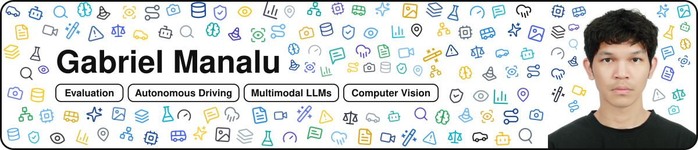

  

  
  
  
  

## About Me

I am a Research Fellow @ [AI² Lab](https://www.resl.kaist.ac.kr), KAIST. My research broadly focuses on evaluating and
improving multimodal models: building benchmarks and datasets that expose where models fail before deployment, and
developing methods to mitigate those failures. I drive the complete model development lifecycle by architecting data
pipelines and formulating robust evaluation frameworks, advancing research in domains ranging from safety-critical
autonomous driving to general computer vision. Currently, I am working on vision-language-action (VLA) models with
reasoning as well as using agents for scenario generation.

I am also quite interested in these domains: agentic AI, synthetic image data generation, and AI in law.

## Select Research

- **Evaluating Video LLMs' Understanding of Corner Cases in Autonomous Driving** (to be presented at BMVC 2026) · First author
- **RADBench: Evaluating Foundation VLMs for Corner Case Description on A Comprehensive Dataset** (IEEE IV 2026, Oral) · First author
- **ClusterSplat: Semantic Cluster Selection for 3D Visual Grounding in Gaussian Splatting** (to be presented at NeurIPS 2026, Spotlight) · Co-author

## Select Skills

## Awards & Scholarships

- **IEEE ITSS Korea Academic Presentation Competition** — Grand Prize (August 2026)
- **POSCO Asia Fellowship** (September 2024 – August 2026)
- **Samsung Global Hope Scholarship** (March 2021 – February 2024)
- **Handong Cornerstone Scholarship** (March 2020 – February 2024)
